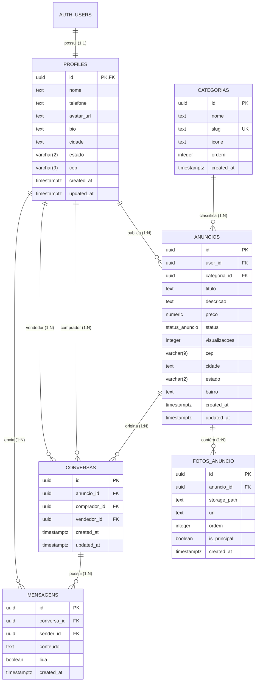

# Documentação da Base de Dados (Supabase / PostgreSQL)

Este diretório contém a modelagem completa e o script SQL para inicialização do back-end do **Clone OLX** utilizando Supabase.

---

## 1. Visão Geral da Arquitetura de Dados

O banco de dados é estruturado para suportar um ecossistema de classificados de alto tráfego com:
- **Autenticação Integrada:** Vínculo direto de `profiles` com `auth.users`.
- **Performance:** Índices B-Tree compostos e índice GIN para busca textual (`full-text search` em português).
- **Segurança Rigorosa:** Row Level Security (RLS) habilitado em 100% das tabelas.
- **Armazenamento Otimizado:** Bucket do Supabase Storage configurado para receber imagens convertidas em WebP.
- **Comunicação em Tempo Real:** Publicação Supabase Realtime habilitada nas tabelas de chat (`conversas` e `mensagens`).

---

## 2. Diagrama de Relacionamento de Entidades (ERD)



---

## 3. Descrição Detalhada das Tabelas

### 3.1 `profiles`
Espelha os dados do usuário autenticado no `auth.users` do Supabase.
- **Trigger `on_auth_user_created`:** Cria automaticamente o perfil público no momento do cadastro (signup).
- **Trigger `trigger_profiles_updated_at`:** Atualiza o campo `updated_at` automaticamente.

### 3.2 `categorias`
Armazena a taxonomia dos anúncios (ex: Autos, Imóveis, Eletrônicos).
- Contém `slug` único para rotas amigáveis de SEO no Next.js (ex: `/categoria/autos-e-pecas`).
- Campo `ordem` para posicionamento no carrossel/grid da Home.

### 3.3 `anuncios`
Tabela central dos classificados.
- `status`: Enum com valores `'ativo'`, `'pausado'`, `'vendido'`, `'excluido'`.
- `visualizacoes`: Contador de acessos ao anúncio.
- Índice GIN `idx_anuncios_busca_textual` para buscas rápidas por termos no título e descrição em português.

### 3.4 `fotos_anuncio`
Galeria de imagens de cada anúncio.
- As imagens devem ser enviadas no formato **WebP** após conversão no cliente (Web ou Mobile).
- `storage_path`: Caminho no bucket `anuncios` (padrão: `{user_id}/{anuncio_id}/{uuid}.webp`).
- `is_principal`: Identifica a foto de capa do anúncio exibida nos cards de listagem.

### 3.5 `conversas`
Representa um canal de negociação privada entre comprador e vendedor para um anúncio.
- Garante unicidade com a constraint `uq_anuncio_comprador` (um comprador tem apenas uma conversa por anúncio).
- Impede que o próprio vendedor abra chat consigo mesmo (`chk_diferente_usuario`).

### 3.6 `mensagens`
Histórico de mensagens do chat em tempo real.
- Suporte a mensagens lidas (`lida: boolean`).
- Atualiza o `updated_at` da conversa vinculada via trigger para ordenar as conversas mais recentes no topo.

---

## 4. Políticas de Segurança (Row Level Security - RLS)

| Tabela | Operação | Permissão | Regra / Condição |
| :--- | :--- | :--- | :--- |
| **`profiles`** | SELECT | Pública | Qualquer pessoa pode ver o perfil público do anunciante |
| **`profiles`** | UPDATE | Dono | Apenas o próprio usuário autenticado (`auth.uid() = id`) |
| **`categorias`** | SELECT | Pública | Leitura liberada para todos |
| **`anuncios`** | SELECT | Condicional | Anúncios com `status = 'ativo'` são públicos; dono vê todos os seus |
| **`anuncios`** | INSERT | Autenticado | Usuário logado vinculando seu próprio `user_id` |
| **`anuncios`** | UPDATE/DELETE | Dono | Apenas o criador do anúncio (`auth.uid() = user_id`) |
| **`fotos_anuncio`** | SELECT | Pública | Fotos de anúncios visíveis |
| **`fotos_anuncio`** | ALL | Dono | Apenas o proprietário do anúncio pode inserir/deletar fotos |
| **`conversas`** | SELECT | Participantes | `auth.uid()` deve ser o `comprador_id` ou `vendedor_id` |
| **`conversas`** | INSERT | Comprador | Apenas usuário autenticado diferente do vendedor |
| **`mensagens`** | SELECT / INSERT | Participantes | Usuário autenticado pertencente à conversa vinculada |

---

## 5. Storage Buckets Configurados

1. **`anuncios`** (Público):
   - Tipos permitidos: `image/webp`, `image/jpeg`, `image/png`.
   - Limite por arquivo: 5MB.
   - Padrão de pastas: `<user_id>/<anuncio_id>/<filename>.webp`.
2. **`avatars`** (Público):
   - Limite por arquivo: 2MB.

---

## 6. Como Executar o Script

### Opção 1: Via Painel do Supabase (Dashboard)
1. Acesse seu projeto em [app.supabase.com](https://app.supabase.com).
2. Vá até o menu **SQL Editor**.
3. Crie uma nova query, copie o conteúdo do arquivo `schema.sql` e clique em **Run**.

### Opção 2: Via Supabase CLI (Local)
```bash
supabase start
supabase db reset
# ou aplicando a migração:
supabase migration new init_schema
# cole o conteúdo de schema.sql no arquivo gerado e execute:
supabase db push
```
